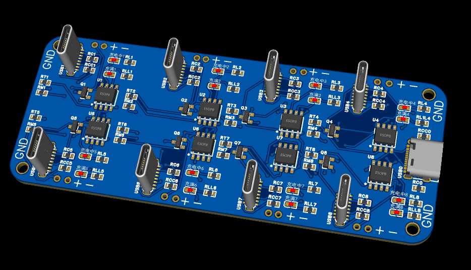
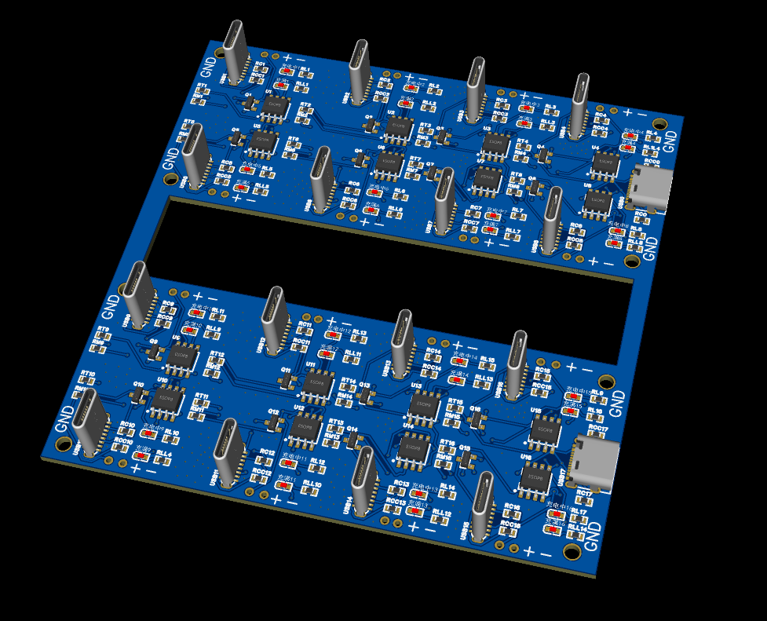
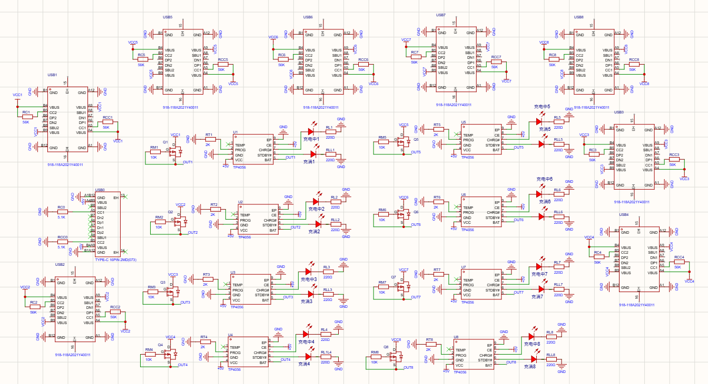
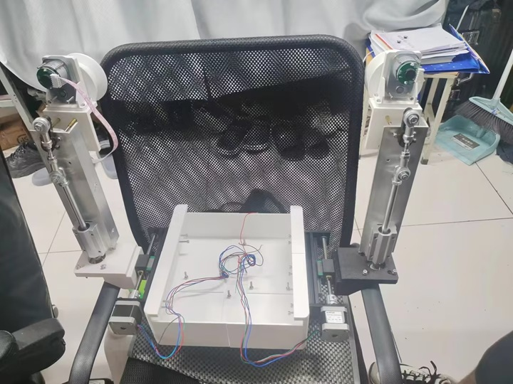
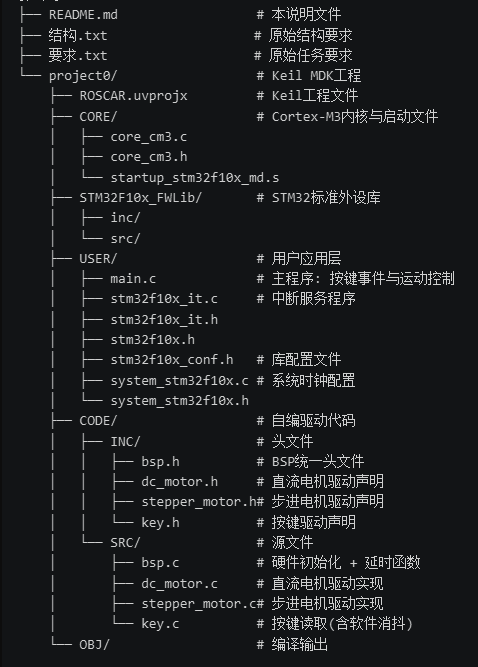

# 按照自己的需求自行寻找对应文件夹

## mahaotian
| 单倍体 | 双倍体|
| ---- | ---- |
| |  |

| 原理图 |
| ---- | 
|  |

| ---- | ---- | ---- | ---- | ---- | ---- | ---- | ---- | ---- | ---- | ---- | ---- | ---- | ---- | ---- | ---- | ---- |
| ---- | ---- | ---- | ---- | ---- | ---- | ---- | ---- | ---- | ---- | ---- | ---- | ---- | ---- | ---- | ---- | ---- |
| ---- | ---- | ---- | ---- | ---- | ---- | ---- | ---- | ---- | ---- | ---- | ---- | ---- | ---- | ---- | ---- | ---- |
| ---- | ---- | ---- | ---- | ---- | ---- | ---- | ---- | ---- | ---- | ---- | ---- | ---- | ---- | ---- | ---- | ---- |

## guoshanqi
| 实物示例 | 代码结构|
| ---- | ---- |
| |  |
