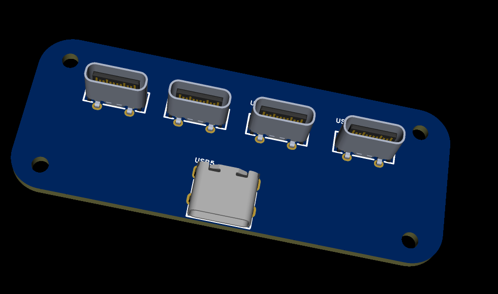
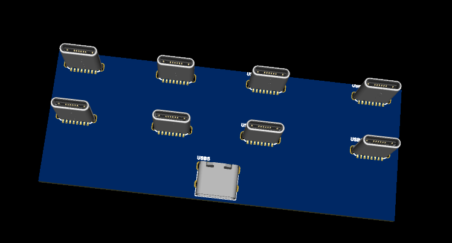
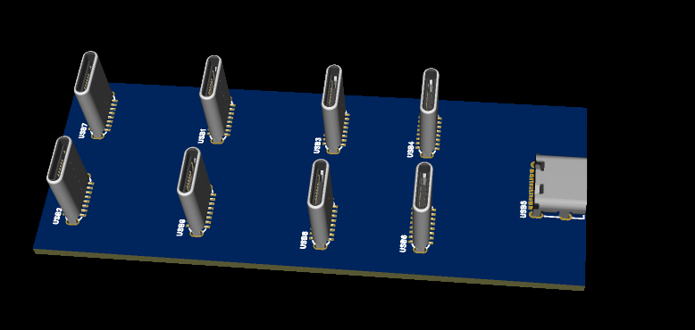
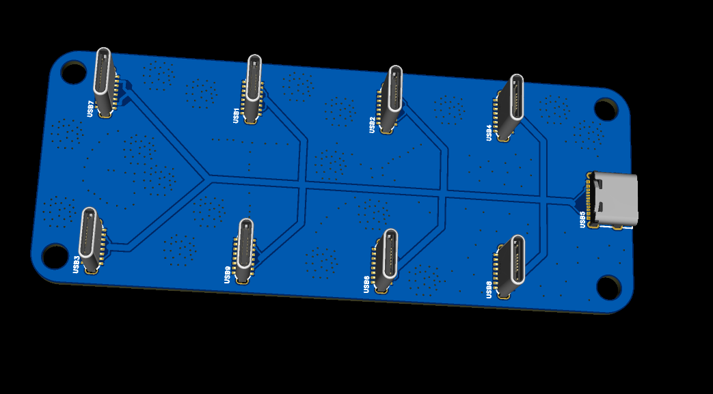
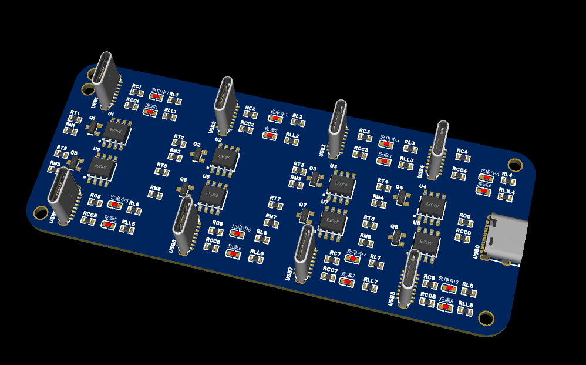
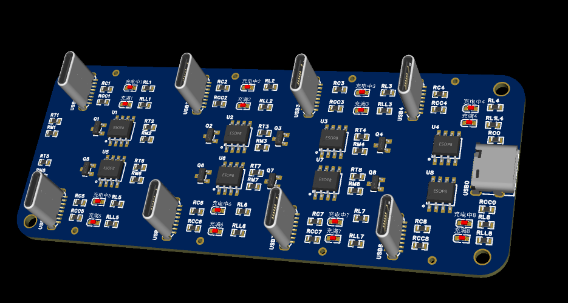
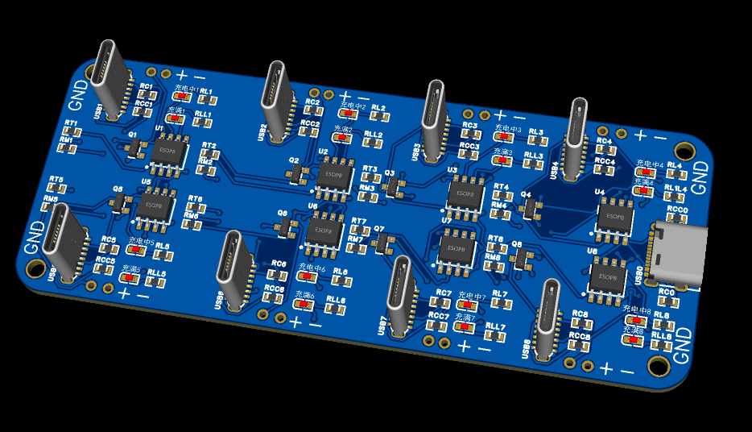

# 锂电池充电模块 — PCB 设计项目

## 项目概述

本项目是一个 **多通道锂电池充电模块** 的 PCB 电路板设计，经历了从初版单芯片方案到多通道独立充电架构的迭代演进。使用立创 EDA 专业版完成原理图绘制、PCB 布局布线及生产文件导出。

---

## 版本总览

| 版本 | 目录 | 设计日期 | 简介 |
|------|------|----------|------|
| **Version 1** | [`version1/`](version1/) | 2026-08-03 | 初版 4-Type Charger，基础锂电充电方案 |
| **Version 2** | [`version2/`](version2/) | 2026-08-06 | 8 路独立 Type-C + TP4056 架构，多通道并行充电 |

### Version 1 — 4-Type Charger（初版）

- 四通道 Type-C 充电器
- 单板尺寸：**30mm × 10mm**（宽 × 厚）
- 详情见 [version1/README.md](version1/README.md)

### Version 2 — 8 路 Type-C 转锂电充放电板（当前最新）

- **8 路完全独立** Type-C 输入通道
- 每路独立 TP4056 锂电充电管理 IC
- 每通道双 LED 状态指示（充电中 / 已充满）
- 第 5 通道预留 CD4066 模拟开关拓展
- 详情见 [version2/README.md](version2/README.md)

---

## 设计迭代历程

以下展示了从 v1 到 v8 共 8 个设计迭代阶段的预览图，记录了本项目从初始方案到最终定型的设计演进过程。

### v1（2026-07-27）— 初始设计



### v2（2026-07-28 上午）— 第一次迭代



### v3（2026-07-28 下午）— 第二次迭代



### v4（2026-07-30）— 第三次迭代



### v5（2026-08-03）— 第四次迭代


### v6（2026-08-05 上午）— 第五次迭代



### v7（2026-08-05 下午）— 第六次迭代



### v8（2026-08-06）— 最终定型



---

## 工程目录结构

```
mahaotian/
├── README.md                              # 项目总说明（本文件）
│
├── version1/                              # Version 1 — 4-Type Charger 初版
│   ├── README.md                          #   V1 详细说明
│   ├── project/                           #   立创 EDA 工程源文件
│   ├── BOM/                               #   物料清单（Excel + 交互式 HTML）
│   ├── DATA/                              #   设计数据（DXF / 电气参数）
│   ├── Export/                            #   生产文件（Gerber / PCB / 原理图 / 3D）
│   ├── photo/                             #   设计预览图（原理图 / PCB / 3D）
│   └── mix/                               #   备注（尺寸说明）
│
├── version2/                              # Version 2 — 8 路 Type-C TP4056 最新版
│   ├── README.md                          #   V2 详细说明
│   ├── Project/                           #   立创 EDA 专业版工程文件
│   ├── BOM/                               #   物料清单（Excel + 交互式 HTML）
│   ├── Export/                            #   生产文件（Gerber / PCB / 原理图 / 3D）
│   └── PHOTO/                             #   设计预览图（原理图 / PCB / 3D）
│
└── 历史版本/                               # 设计迭代历史截图
    ├── v1.png                             #   2026-07-27 初始设计
    ├── v2.png                             #   2026-07-28 第一次迭代
    ├── v3.png                             #   2026-07-28 第二次迭代
    ├── v4.png                             #   2026-07-30 第三次迭代
    ├── v5.png                             #   2026-08-03 第四次迭代
    ├── v6.png                             #   2026-08-05 第五次迭代
    ├── v7.png                             #   2026-08-05 第六次迭代
    └── v8.png                             #   2026-08-06 最终定型
```

---

## 版本演进说明

| 阶段 | 日期 | 关键变更 |
|------|------|----------|
| v1 ~ v4 | 07-27 ~ 07-30 | 初始方案探索与验证，确定基本架构 |
| v5 | 08-03 | 第一版正式归档（Version 1: 4-Type Charger） |
| v6 ~ v7 | 08-05 | 架构升级，从单芯片方案转向多通道独立 TP4056 |
| v8 | 08-06 | 最终定型（Version 2: 8 路 Type-C 独立充电），正式归档 |

> 💡 **核心演进方向**：从单 TP4056 共享方案 → 8 路独立 TP4056 架构，实现真正的多通道隔离独立充电，单路故障不影响其余通道。

---

## 快速开始

| 需求 | 入口 |
|------|------|
| 查看最新设计 | [`version2/`](version2/) |
| 查看上一版设计 | [`version1/`](version1/) |
| 浏览设计迭代过程 | [`历史版本/`](历史版本/) |
| 直接制板生产 | [`version2/Export/Gerber_PCB1_2026-08-06.zip`](version2/Export/Gerber_PCB1_2026-08-06.zip) |
| 编辑工程 | 使用立创 EDA 专业版打开对应 `.epro2` 文件 |

---

## 技术栈

| 项目 | 详情 |
|------|------|
| 设计工具 | 立创 EDA 专业版（`.epro2`） |
| 核心芯片（V2） | TP4056 × 8（锂电线性充电管理） |
| 输入接口 | 16Pin 2MD Type-C 母座 × 8 |
| 充电对象 | 单节锂电池（4.2V 满充） |
| 输入电源 | 5V USB 适配器 |
