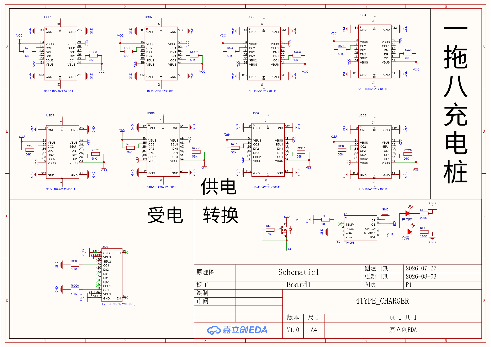
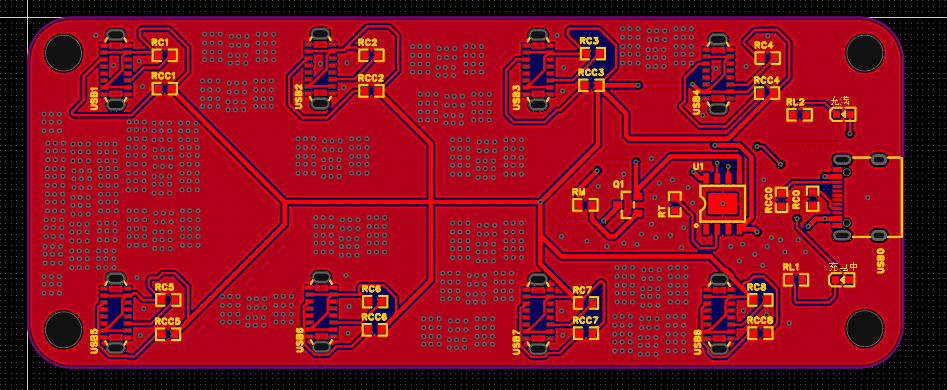
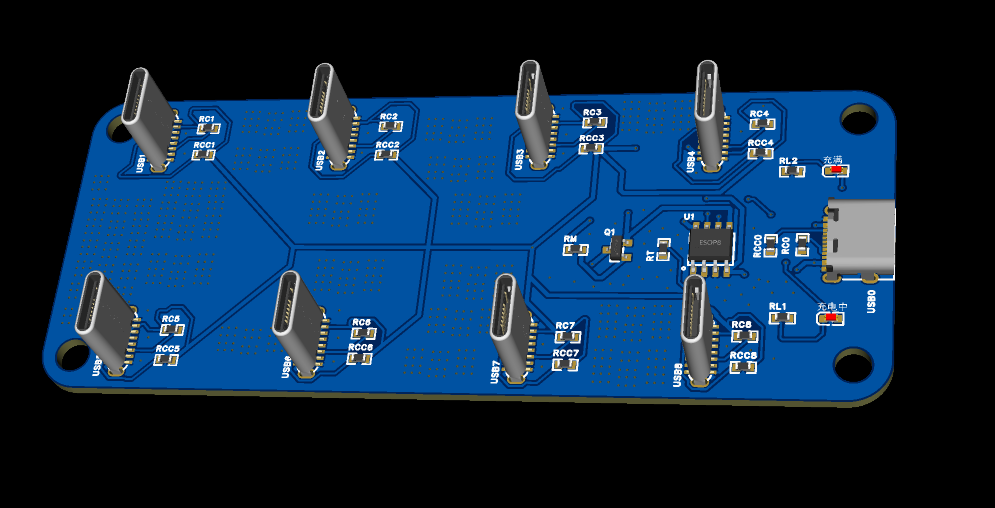

# 4-TYPE CHARGER — PCB 设计项目

## 项目简介

本项目是一个 **八通道充电器（4-Type Charger）** 的 PCB 电路板设计，使用专业 EDA 工具完成原理图绘制、PCB 布局布线以及生产文件导出。

| 项目信息 | 详情 |
|---------|------|
| 项目名称 | 4TYPE_CHARGER |
| 设计工具 | 立创 EDA / EasyEDA（`.epro2` 格式） |
| 最后更新 | 2026-08-03 |
| 单板尺寸 | **30mm × 10mm**（宽 × 厚） |

---

## 目录结构

```
mahaotian/
├── README.md                          # 项目说明文档（本文件）
├── project/                           # 工程源文件
│   └── ProPrj_4TYPE_CHARGER_*.epro2   # EDA 工程文件（原理图 + PCB）
├── BOM/                               # 物料清单
│   ├── BOM_Board1_PCB1_*.xlsx         # Excel 格式 BOM 表
│   └── InteractiveBOM_PCB1_*.html     # 交互式 BOM（浏览器查看）
├── DATA/                              # 设计数据
│   ├── DXF_PCB1_*.dxf                 # PCB 机械图层（AutoCAD 2007 格式）
│   └── ELEC.jpg                       # 电气特性/参数截图
├── Export/                            # 生产导出文件
│   ├── Gerber_PCB1_*.zip              # Gerber 制板文件
│   ├── PCB_PCB1_*.pdf                 # PCB 布局图（PDF）
│   ├── SCH_Schematic1_*.pdf           # 原理图（PDF）
│   └── 3D_PCB1_*.step                 # 3D 结构模型（STEP 格式）
├── photo/                             # 设计预览图
│   ├── 原理图.png                      # 原理图截图
│   ├── PCB.png                        # PCB 布线截图
│   ├── 3D.png                         # 3D 视图（正面）
│   └── 3D_.png                        # 3D 视图（背面）
└── mix/                               # 杂项/备注
    └── 尺寸.txt                        # 单板尺寸说明
```

---

## 设计预览

### 原理图



### PCB 布线



### 3D 预览 — 正面



---

## 文件说明

### 📁 `project/` — 工程源文件

`.epro2` 是 EDA 工具的原生工程文件格式，包含完整的原理图设计和 PCB 布局布线数据。使用支持的 EDA 软件（如立创 EDA）打开即可编辑和查看。

### 📁 `BOM/` — 物料清单

- **`BOM_Board1_PCB1_*.xlsx`**：Excel 格式的物料清单，列出 PCB 上所有元器件的编号、封装、参数、用量等信息，方便采购。
- **`InteractiveBOM_PCB1_*.html`**：交互式 HTML BOM，在浏览器中打开后可点击对应元器件，PCB 上对应位置会高亮显示，便于手工焊接时定位。

### 📁 `DATA/` — 设计数据

- **`DXF_PCB1_*.dxf`**：PCB 外形机械图，AutoCAD 2007 格式，可用于结构工程师进行外壳设计或机械配合校验。
- **`ELEC.jpg`**：电气特性参数截图，记录了电路的关键电气指标。

### 📁 `Export/` — 生产导出文件

- **`Gerber_PCB1_*.zip`**：Gerber 制板文件压缩包，可直接提交给 PCB 厂商进行生产制造。
- **`PCB_PCB1_*.pdf`**：PCB 布局图 PDF，用于审阅和归档。
- **`SCH_Schematic1_*.pdf`**：原理图 PDF，用于电路审阅、调试参考和归档。
- **`3D_PCB1_*.step`**：3D 结构模型文件（STEP 格式），可导入 SolidWorks、Fusion 360 等机械 CAD 软件进行外壳装配验证。

### 📁 `photo/` — 设计预览图

存放各角度的设计截图，方便快速预览而无需打开 EDA 软件。

### 📁 `mix/` — 备注

**尺寸说明**（`尺寸.txt`）：

> - 设计板宽：27mm → 按 **30mm** 使用（留出余量）
> - 设计板厚：6mm + 4mm = 10mm
> - **最终尺寸：30mm × 10mm**（宽 × 厚）

---

## 版本历史

| 日期 | 说明 |
|------|------|
| 2026-08-03 | 初版完成，设计输出归档 |

---

## 备注

- 文件名中的日期（如 `2026-08-03`）为导出日期，后续更新时会相应变化。
- Gerber 文件可直接提交制板，建议下单前使用 DFM 工具检查。
- 3D 模型可用于结构工程师进行外壳装配干涉检查。
