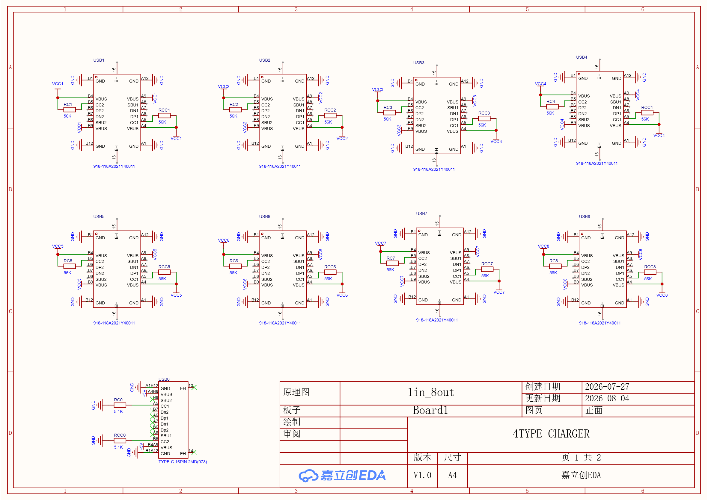
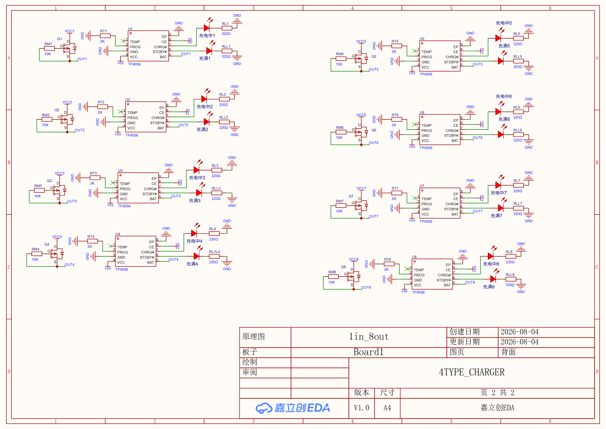
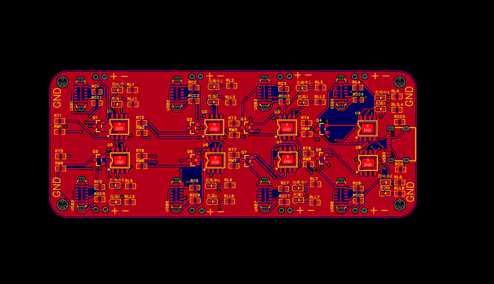
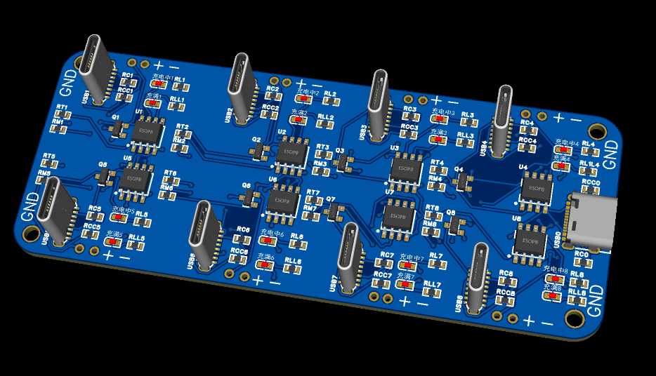

# 8 路 Type-C 输入 5V 转锂电充放电板 — Version 2

## 项目简介

本项目是一块 **8 路完全独立通道的锂电池充电模块**，输入统一 5V，每路独立 Type-C 接口取电、独立 TP4056 锂电充电管理，8 路充电通道互不干扰，可同时给 8 组锂电池独立充电。

原理图分为两页：Type-C 输入接口区（USB1~USB8 共 8 路）、 TP4056 充电电路区。

---

## 整体架构

| 模块 | 说明 |
|------|------|
| 输入接口 | 8 路 16Pin 2MD Type-C 母座，CC 脚 5.1K 下拉电阻满足 5V 识别 |
| 充电芯片 | 每路独立 TP4056 线性锂电充电 IC，共 8 片 |
| 状态指示 | 每通道双 LED（充电中 / 已充满），220Ω 限流 |
| 拓展功能 | 第 5 通道预留 CD4066 模拟开关，可外控电池输出通断 |
| 设计输入 | 5V USB 适配器供电 |
| 设计输出 | 单节锂电池（4.2V 满充） |

---

## 电路特点

- **八路完全隔离独立**：8 路 Type-C 输入、8 片独立 TP4056，单路故障不影响其余通道
- **标准化 Type-C 5V 输入**：CC 脚 5.1K 下拉电阻兼容常规 USB 适配器
- **完善充电状态指示**：每通道双 LED 独立区分充电 / 充满状态
- **基础可拓展设计**：第 5 路预留模拟开关控制电池输出，其余通道可按需增加
- **线性充电方案**：TP4056 外围电路极简，稳定性高，适合小电流锂电充电场景

---

## 目录结构

```
version2/
├── README.md                                  # 本说明文档
│
├── BOM/                                       # 物料清单
│   ├── BOM_Board1_PCB1_2026-08-06.xlsx        #   Excel 格式物料清单
│   └── InteractiveBOM_PCB1_2026-8-6.html      #   交互式 BOM（浏览器打开可交互查看）
│
├── Export/                                    # 生产制造文件
│   ├── SCH_1in_8out_2026-08-06.pdf            #   原理图 PDF（含正面 Type-C 输入 + 背面充电电路）
│   ├── PCB_PCB1_2026-08-06.pdf                #   PCB 图纸 PDF
│   ├── Gerber_PCB1_2026-08-06.zip             #   Gerber 制板文件（可直接发板厂）
│   └── 3D_PCB1_2026-08-06.step                #   3D 模型 STEP 文件
│
├── PHOTO/                                     # 预览图片
│   ├── SCH_1in_8out_1_2026-08-06.png          #   原理图第 1 页 — 正面 Type-C 输入接口区
│   ├── SCH_1in_8out_2_2026-08-06.png          #   原理图第 2 页 — 背面 TP4056 充电电路区
│   ├── PCB_PCB1_2026-08-06.png                #   PCB 板预览图
│   └── 3d.png                                 #   3D 渲染预览图
│
└── Project/                                   # 工程源文件
    └── ProPrj_1IN_8OUT_2026-08-06.epro2       #   立创 EDA 专业版工程文件
```

---

## 设计预览

### 原理图第 1 页 — Type-C 输入接口区



### 原理图第 2 页 —  TP4056 充电电路区



### PCB 布线



### 3D 预览



---

## 单路充电通道原理简述

以单路（如 USB1 → U1 TP4056）为例：

1. **Type-C 输入**：USB-C 接口 VBUS 接 +5V，CC1/CC2 各 5.1K 下拉至 GND，通知适配器输出 5V
2. **TP4056 供电**：VCC（4 脚）接 5V，CE（8 脚）接 5V 使能，TEMP（1 脚）接地简化
3. **充电输出**：BAT（5 脚）接锂电池正极，PROG（2 脚）外接电阻设定充电电流
4. **状态指示**：CHRG#（7 脚）驱动红色 LED 指示充电中，STDBY#（6 脚）驱动绿色 LED 指示充满
5. **散热**：EP（9 脚）接地焊盘辅助散热

其余 7 路完全复刻此电路，参数一致。

---

## 版本信息

| 项目 | 信息 |
|------|------|
| 版本号 | Version 2 |
| 设计日期 | 2026-08-06 |
| 设计工具 | 立创 EDA 专业版 |
| 工程文件 | `Project/ProPrj_1IN_8OUT_2026-08-06.epro2` |

> 💡 **版本演进说明**：本版（Version 2）在前版基础上进行了优化迭代，弃用了单 TP4056 方案，改为 8 路独立 TP4056 架构，实现真正的多通道独立充电。
