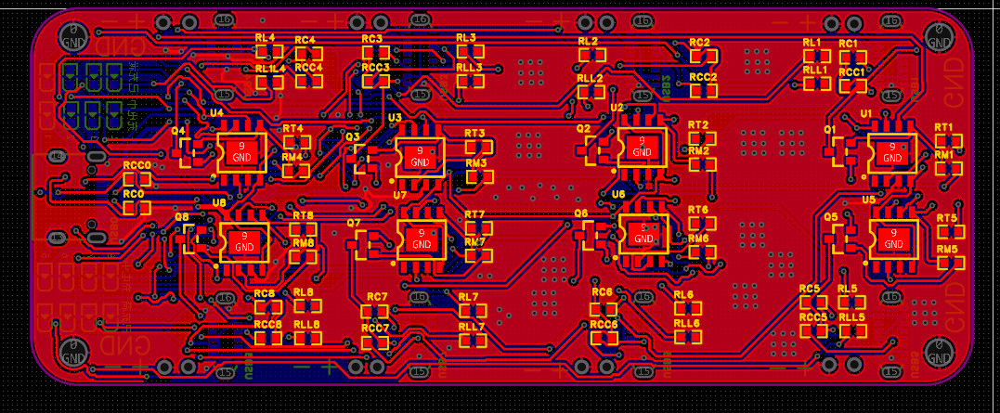
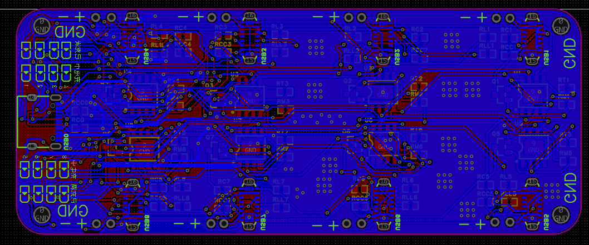
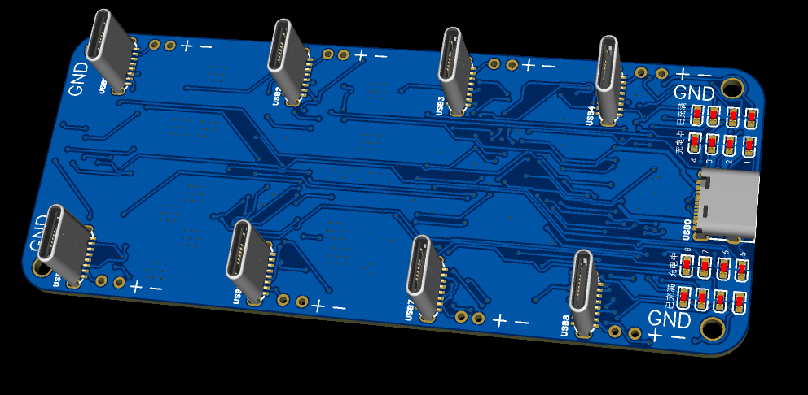
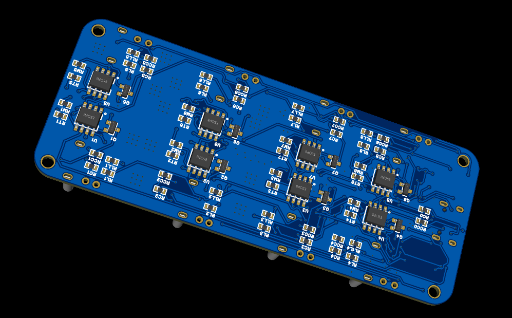

# 欣赏布线

|PCB正面|PCB背面|
|---|---|
|||
-----------------------------

|3D图正面|3D图背面|
|---|---|
|||
-----------------------------

###### 此次将正反面区分,正面只方typec,元器件全部放在背面
###### 并且将调试焊盘由TP4056引出改为从MOS管引出

